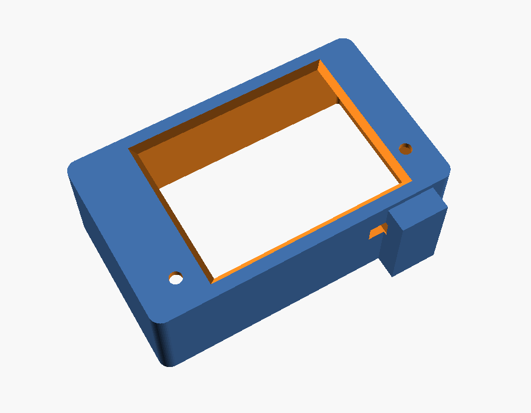
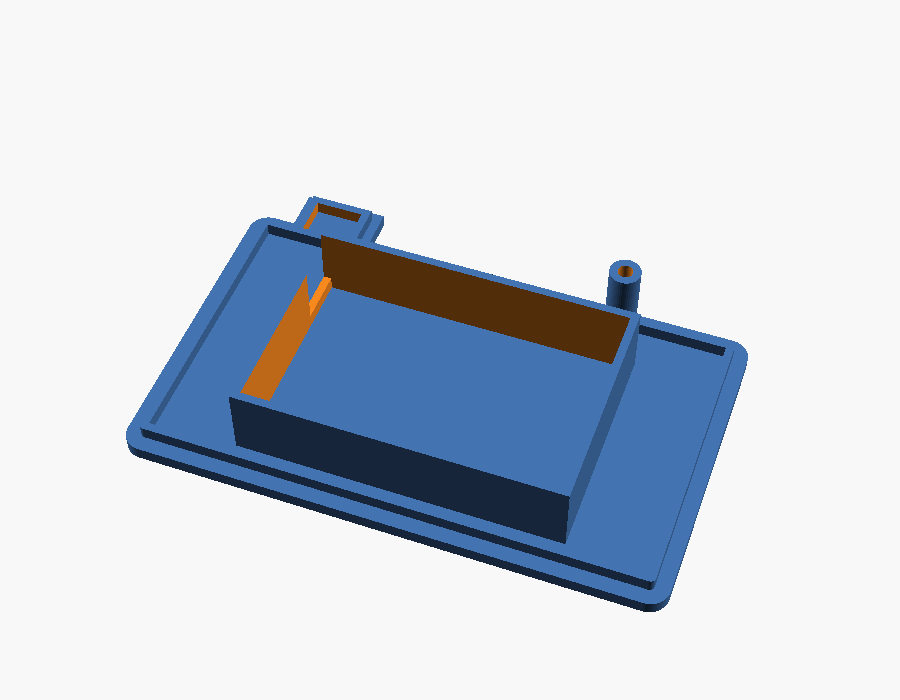

# Buddies

Two little Home Assistant gadgets built on the 2.4" "Cheap Yellow Display"
(ESP32-2432S024R, resistive touch, USB-C), running [ESPHome](https://esphome.io) with LVGL.

| Buddy | What it does | Config |
|-------|--------------|--------|
| **Desk Buddy** | Energy and home dashboard on your desk. Robot eyes in standby, the mood follows your house data (solar, grid, battery, time of day). | [`esphome/deskbuddy.yaml`](esphome/deskbuddy.yaml) |
| **Music Buddy** | Kid-friendly Sonos/Spotify remote: cover-art tiles for music and audio stories, play/pause, skip, volume. Same robot eyes when idle. | [`esphome/musicbuddy.yaml`](esphome/musicbuddy.yaml) |

A parametric OpenSCAD case for both lives in [`case/`](case/).

## Getting started

1. Copy `esphome/secrets.yaml.example` to `esphome/secrets.yaml` and fill in your Wi-Fi,
   an API encryption key per device (`openssl rand -base64 32`) and the fallback hotspot passwords.
   `secrets.yaml` is git-ignored.
2. Replace the example entity IDs with your own (see below).
3. Flash once over USB (ESPHome Builder or `esphome run esphome/deskbuddy.yaml`), after that OTA works.
4. Add the device in Home Assistant (ESPHome integration).

## Desk Buddy

Swipeable pages for energy (battery, PV, house, grid), heating (indoor, outdoor, flow
temperature, hot water, heat pump), status (clock, robot vacuum, wallbox) and a desk lamp
(on/off, brightness, colour temperature; set `desk_light` in `substitutions:`). After 30 s
without touch it cycles through the pages; the BOOT button toggles the standby face.

- All Home Assistant entities are in the `sensor:` / `text_sensor:` / `binary_sensor:` blocks
  (`sensor.solar_power`, `sensor.grid_power`, `climate.heat_pump_flow_offset`, ...).
  They are generic examples, swap them for yours or delete the cards you don't need.
- Mood thresholds, brightness and page timing are `substitutions:` at the top.
- The `Face mood` select in Home Assistant forces a mood (handy for photos), `Auto` is the default.
- Some UI labels are German (it lives on a German desk). Change them in the LVGL section.

## Music Buddy

- Needs the Sonos integration in Home Assistant, Spotify linked in the Sonos app, and in the
  device options of the buddy: "Allow the device to perform Home Assistant actions".
- Up to five speakers (`box1_entity` ... `box5_entity`), selectable via the `Sonos-Box` select in HA.
- Tiles: `music1`/`story1` ... in `substitutions:` hold a name, a Spotify link and a cover URL.
  The two playlist links are placeholders (`YOUR_PLAYLIST_ID`), put in your own.
  Covers are downloaded at compile time; get the URL via
  `https://open.spotify.com/oembed?url=<spotify link>` → `thumbnail_url`.
- Set the volume limit in the Sonos app, the speaker enforces it.
- The UI is in German (made for kids), change the labels in the LVGL section.

## Case

[`case/buddy-case.scad`](case/buddy-case.scad) is parametric OpenSCAD. Pick the part with
`part = "desk_front" | "desk_back" | "stand" | "music_front" | "music_back" | "preview_desk" | "preview_music"`.
The Music Buddy version has a battery bay (default 45 x 30 x 10 mm LiPo) behind the board.

Ready-made STLs for the Music Buddy are in [`case/stl/`](case/stl/). Measure your board
(display thickness, button height) and do a test print first; positions come from the
manufacturer drawing and photos.

| Front, inside | Back with battery bay |
|---|---|
|  |  |

## License

MIT
